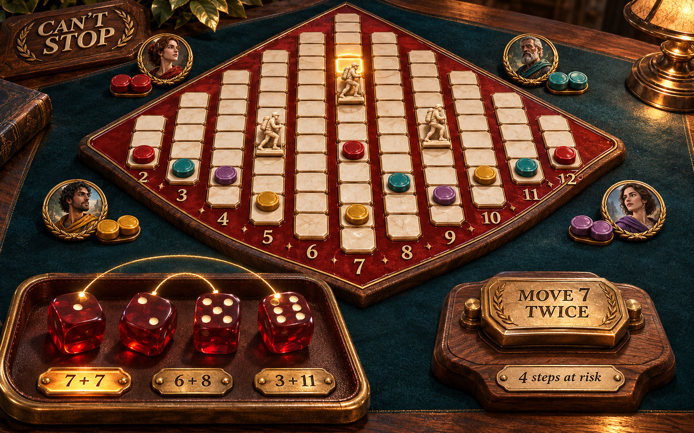
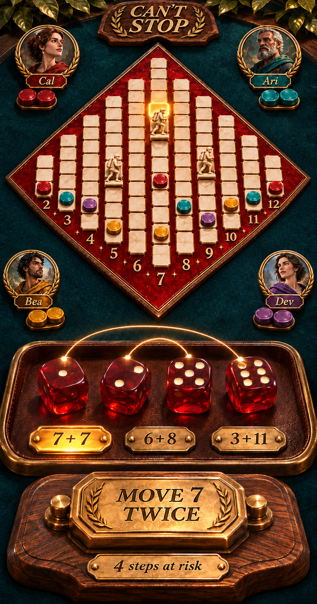
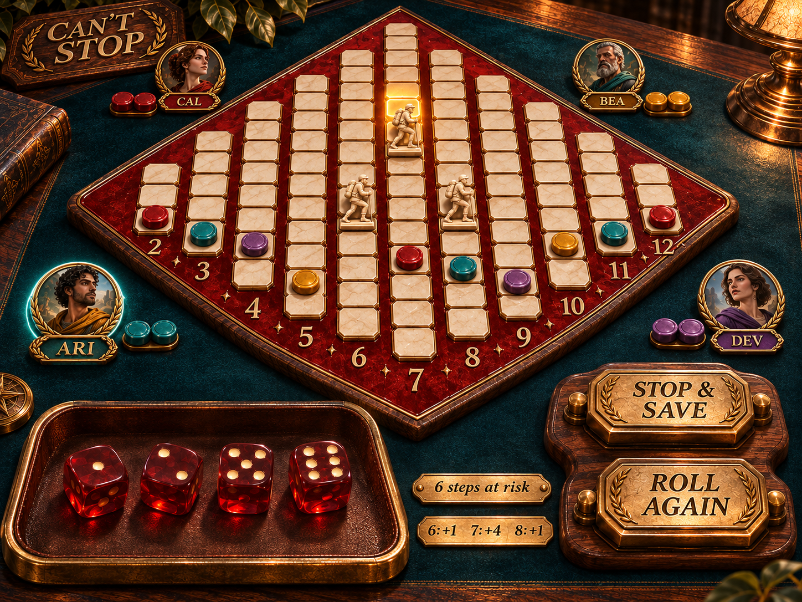
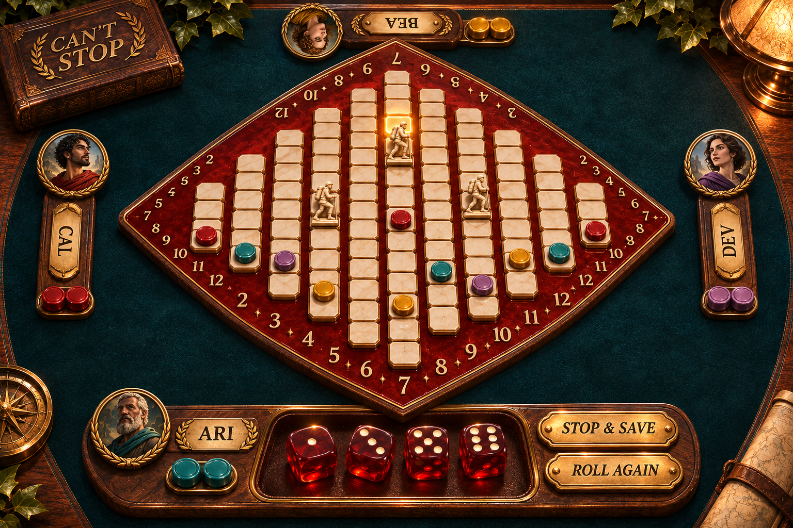
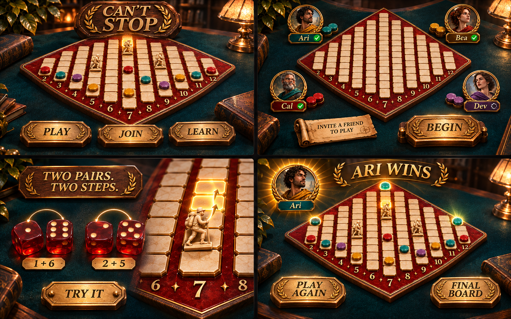
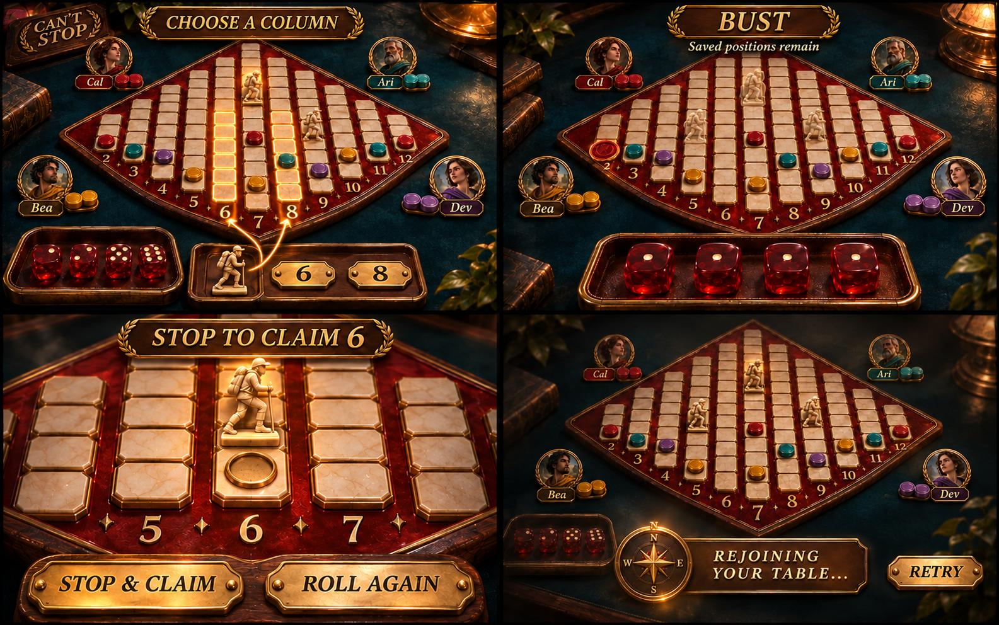

# Can’t Stop — experience and interaction design

**Status: proposed design for review.** This document describes the game experience before technical planning. The concept paintings establish a rich graphical game scene, physical materials, and composition for each form factor. They are art-direction proposals, not screenshots of a working game or approved final artwork. A desktop and phone **component gallery and animation lab** now implement the first visual prototype; see [README.md](README.md) for the local review links. Multiplayer, tabletop, and TV implementation remain outside this prototype.

**The promise:** four dice, three runners, one very tempting next roll. Everyone should be able to see what is safe, what is at risk, and why the next decision matters. Winning means being first to **claim three columns by stopping**, rather than simply touching three summits.

## 1. Direction and scope

The starting point is [Pantheon’s UX design](../pantheon/UX_DESIGN.md), particularly its “table is the interface” principle, distinct desktop and phone compositions, tactile pieces, visible destinations, and continuity when inspecting rules or returning after an interruption. Its [desktop table concept](../pantheon/docs/ux/concepts/04-table-desktop.png), [mobile concept](../pantheon/docs/ux/concepts/04-table-mobile.png), and [shared-table concept](../pantheon/docs/ux/concepts/16-tabletop.png) informed the spatial approach.

For Can’t Stop, that means a **crafted square board rotated 45° on a richly lit gaming table**, real-looking dice, and pieces with weight, depth, and material character. The scene should look like a finished board-game video game before the player reads a word. A carved walnut rim, deep red lacquer, ivory playing spaces, translucent ruby dice, and a dark felt or leather playing surface give it a distinctive physical presence.

The rotated square silhouette, physical dice, and rich graphical materials are required across every form factor. The concept paintings below establish atmosphere; the live prototype supersedes their board proportions and piece palette. The earlier flat wireframes are superseded. The user journeys describe behavior within this game scene.

The board is the hero. Environmental lighting, bevels, grounded shadows, reflections, and small crafted details should create richness without covering the tracks. Controls belong on the table as engraved plaques, sculpted seals, dice cradles, and player medallions. The screen has no persistent website header or dashboard sidebar. Pantheon is the reference for the level of finish and atmosphere; this game has its own materials and silhouette.

### Proposed play modes

| Mode | Player’s starting intention | Experience |
| --- | --- | --- |
| Play with friends | “We’re in different places.” | Invite-only live table; each person uses a phone, tablet, or computer. Devices can be mixed. |
| Play on one device | “We’re here together.” | Two to four named seats share a phone, tablet, or computer. Public information means there is no hand-hiding screen. |
| Shared touch table | “We’re sitting around a large screen.” | One central board, controls at the active player’s edge, and seat information facing each person. |
| Shared display + phones | “Put the board on the TV.” | Read-only public display; each seated player uses their normal personal play view. |
| Learn by playing | “Show me how this works.” | Short, solo guided examples with controlled rolls; then an invitation to start a normal game. |

“Web” means the desktop/laptop browser composition. Phone and tablet are equally complete touch experiences, whether opened in a browser or later presented as an installed app; installation is never needed to join. **Tabletop means a digital shared surface**, including horizontal touch tables and a vertical shared display. A manufactured board, printable edition, and physical-dice companion are separate potential projects, not assumptions in this proposal.

The initial review scope is the classic two-to-four-player game, invite-only live play, local shared-device play, learning, and recovery. Public matchmaking, rankings, chat, bots, tournaments, alternate rules, and asynchronous notifications are outside this first design. Leaving those out keeps the first review about the quality of playing Can’t Stop.

## 2. Rules that shape the experience

The publisher describes the central loop as pairing four dice, climbing numbered tracks, and risking the progress of the current turn when rolling again. The objective is three completed columns. See [Eagle-Gryphon’s game description and rulebook link](https://www.eagle-gryphon.com/products/cant-stop-1). The detailed turn examples were also checked against this [two-page rules reference](https://cdn.1j1ju.com/medias/d8/88/07-cant-stop-rulebook.pdf). The reference is a secondary transcription; its discussion of availability is historical, not a current product claim.

The following is the proposed classic-rules contract for this design. Any edition-specific difference should be resolved during design review and then applied consistently to help, previews, and play.

- The board contains eleven columns, numbered 2 through 12. Their lengths are **3, 5, 7, 9, 11, 13, 11, 9, 7, 5, 3** spaces, including the summit space.
- Each player has a permanent saved position in each column they have advanced. Three neutral runners mark only the current player’s progress this turn.
- Four dice form two disjoint pairs. Each die is used exactly once. Offer every distinct legal outcome; identical dice may reduce the number of different choices.
- A runner starts one space beyond that player’s saved marker, or on space one if there is no saved marker. A runner already in that column advances one space for each usable sum.
- A maximum of three different columns can be active during a turn. Runners cannot move between columns. Pieces may share a space; there is no blocking or jumping over opponents.
- Within a selected pairing, apply both sums when possible. One usable sum is enough to survive. If one unused runner could start either of two new columns, the player chooses which column gets it. A pairing with fewer moves can still be chosen; the interface must not force the most productive pairing across the entire roll.
- Equal sums can move one runner twice, subject to the summit limit. Excess movement beyond a summit is unused. No fourth runner is created.
- A summit reached during a turn is provisional. Its runner remains occupied, cannot advance farther, and is not available for a new column.
- Stopping saves the current runner positions. A saved summit claims that column, removes other players’ markers there, and closes that number to everyone, including its owner.
- A bust occurs only when **no pairing permits any advance**. Only this turn’s provisional progress is lost; earlier saved positions and claimed columns remain.
- Claiming a third column by stopping wins immediately. There is no final round or catch-up turn. If every active runner is already at a summit, rolling again necessarily busts; retain the choice with an explicit warning rather than silently saving.

### Starting player

For a familiar physical-game ritual, each seat rolls two dice during setup; highest total starts, tied highest seats reroll. The game performs the ritual together after everyone is ready and shows the result without requiring a succession of acknowledgments. Local seating order is clockwise; an online table uses its visible seat order throughout the match. There is no turn timer by default.

### Shared language

| Term shown to players | Meaning |
| --- | --- |
| Saved marker | A player’s permanent position from an earlier stopped turn. |
| Runner | A black pawn representing progress that can still be lost. |
| At risk | Spaces gained this turn, across all active columns. These are explanatory counts, not victory points. |
| Claim | Save a runner at the summit; the whole column closes. |
| Pairing | One way of splitting the four dice into two pairs. |
| Bust | This roll cannot move any runner; the turn ends without saving. |

Use “Stop & save” as the normal committing label. Use “Stop & claim 6” or “Stop & win” when that accurately describes the consequence. Avoid “bank” in the first-time explanation and “score” for ordinary spaces.

## 3. Visual system and board grammar

The board is the dominant object on every device. It is a true square rotated 45°, with equal diagonals, four right angles, and a vertex pointing toward each edge of the screen. All eleven columns retain their order and relative lengths. The tracks are vertically centered around the board’s horizontal equator: both their starting spaces and summits follow the sloping diamond edges. They do not share one flat baseline. There is no carousel of columns and no switching between “my board” and “their board.” Competition remains visible together.

### What each mark means

| Element | Visual treatment | Information available without color |
| --- | --- | --- |
| Saved position | Solid wood/resin token with a carved owner mark, highlights, and a contact shadow | Ari: ring; Bea: square; Cal: triangle; Dev: diamond. Owner name appears on inspection. |
| Current runner | Polished black pawn, visibly taller than saved pieces, with the same base diameter | Pawn silhouette, “Runner,” current column and space. |
| Progress at risk | Restrained illuminated track inlay from saved position to runner | Text such as “7: saved 5 → now 7, +2.” |
| Selected move preview | Empty destination socket with a warm light; no solid piece | “Preview: 7 → 9.” It never looks like a saved piece. |
| Claimed column | Owner token at summit; quiet track with a closure indication | “10 claimed by Ari.” No legal-move highlight. |
| Active player | Lit player medallion and explicit turn sentence on its nameplate | “Ari’s turn” or “Your turn.” |

A saved position stays visible while its runner advances. All board pieces use the larger common footprint and sit at the exact centre of their square. Shared positions stack vertically in stable owner order; a runner rests above any saved markers in that square. Inspection expands the cell into a labeled list; never imply one player is ahead because their marker was drawn higher. At the same position as a runner, keep both the saved token and runner identifiable.

On a phone the board is an overview. Choosing dice happens in large controls below it, so the tiny individual board spaces do not need to be touch targets. A board-wide “Inspect board” action opens an accessible list of columns, owners, saved spaces, and runner spaces; tapping a column label can open the same information directly where space allows.

### Materials, typography, and motion

**Board:** a substantial square of deep red lacquer or enamel, rotated 45°, with a dark walnut bevel, fine brass edging, and ivory inset spaces. Tracks remain readable under the lighting. The backing has four equal sides and four right angles. Equal horizontal and vertical spacing gives the tracks a square grid; their endpoints and number ribbon follow the 45° edges. The concentric walnut, brass and lacquer layers are all true squares with parallel edges. The full tile-and-number composition is centred in that outline, with every tile socket and number label fully supported by the lacquer. The eleven numbers stand alone along the sloping ribbon, without diamond flourishes. The longest track, 7, crosses the center from near the lower vertex to near the upper vertex. Shorter tracks sit successively toward the left and right vertices. No painted mountain backdrop substitutes for the board’s actual geometry.

**Dice:** four real-looking rounded cubes in translucent ruby resin, with recessed ivory pips, visible side faces, reflections, and soft contact shadows. They land at natural angles in a leather-lined throwing area. The top face is always readable; perspective must not make a side-face value ambiguous. During pairing, two restrained light threads or matching cradle marks identify the two disjoint pairs. The dice themselves remain the focal objects, rather than shrinking into flat icons inside choice cards.

**Pieces:** saved tokens are low, polished objects; the three black pawns have a distinct taller silhouette. Owner shapes are engraved or embossed, not merely suggested by color. Claimed summits receive a permanent owner piece and an unmistakable closure treatment. Glow communicates focus or a destination, never an unearned claim.

**Table and lighting:** warm grazing light across wood grain, cool reflected fill on lacquer, and soft shadows under every loose object. The surrounding table may have rich felt, leather, and subtle carved details. Keep ornamental detail out of the spaces and pips. Perspective is shallow enough to preserve board legibility, becoming nearly overhead on small screens and shared tables.

**Controls:** carved or brass-inlaid action plaques at the near edge, player portrait/token medallions around the table, and an engraved risk tally beside the dice. Pairing choices are small physical number tabs or dice cradles within the scene. Their hit areas can be generous without drawing web-style rectangles around everything. Rules and history open as a readable game folio or table overlay, with a clear close action.

**Type:** a distinctive title engraved into the scene; large, crisp board numerals; short readable labels on physical controls. Generated lettering in the paintings is illustrative. Final labels must remain selectable/readable where appropriate and must use the exact language defined in the interaction sections. Rich materials do not justify blurry type or tiny controls.

Dice settle together; a committed pairing moves runners to their destinations; stopping replaces their positions with the player’s saved markers. A claim briefly lights the summit, then leaves a permanent owner indication. A bust returns runners to the tray while saved pieces remain. Keep these transitions short enough that repeated rolls feel quick. No screen shake, falling-player spectacle, taunts, or flashing warnings.

Reduced motion uses direct state changes plus the same written outcome. Sound and haptics are optional, separately controlled, and never carry information alone. A ruby-dice clatter, a softer save sound, and a restrained summit cue can distinguish the moments without making a shared room noisy.

### Approved dark pieces and pawn staging

**Approved:** ivory track squares, polished black pawns, and darker teal, ochre, oxblood and violet player markers. The alternative finishes and comparison controls have been discarded. Owner medallions and claim tokens follow the same palette, with pale engraved identity marks.

Action controls use pale maple with fine, gently curling grain on walnut bodies and dark engraved lettering. Selected buttons use a warmer maple tone; both normal and selected controls retain their maple finish. The Action pieces gallery shows both states together. A large sample of the same maple appears in the Materials gallery alongside walnut and lacquer. Closed-column numbers are muted and crossed out in the number ribbon. Pairing numbers use this same inactive treatment whenever that sum cannot advance: a closed column, no spare pawn, a summit, or an unchosen last-pawn destination. Both possible last-pawn destinations remain active until the player chooses one. A pairing with one usable sum remains available; its move plaque names only the usable column, and a short closed-number note explains the omitted move. Keyboard pairing labels explicitly identify closed sums.

All pieces on the board use the larger base diameter, including ordinary saved markers, claims, and pawns. Every piece is centred on its square. Shared positions stack upward rather than using owner-specific horizontal offsets.

The three unused black pawns stand on an ivory disk atop a small round walnut-and-brass podium, to the lower left of the diamond. The same three slots define the start and end of pawn travel. Saving or busting returns the pawns visibly to that podium without shrinking or fading them away.

The lab has explicit Desktop, Portrait and Landscape preview choices. Switching between phone orientations preserves the current roll, choice, and animation time. The paintings below predate these material and staging decisions; the live prototype is authoritative for the approved black pieces, podium and centred placement.

## 4. Graphical mockups by form factor

The [concept paintings](docs/ux/concepts) are the current visual target. They were made with the built-in image-generation tool; [the complete prompts and reference roles](docs/ux/concepts/prompts.json) are saved beside them. These are full-screen game compositions, without browser chrome or device frames. They establish materials, depth, object placement, and atmosphere.

The rules and exact track lengths in section 2 remain authoritative. Generated miniature numbers, incidental piece positions, pips, and lettering are illustrative and must be checked against those rules when the design becomes interactive. A painting must not introduce a new rule. All final boards must have exactly eleven tracks numbered 2–12 with the specified lengths.

The interaction example remains: saved positions **6:3, 7:5, 8:2**; runners **6:4, 7:7, 8:3**; four spaces at risk. Dice **1, 2, 5, 6** offer **3+11**, **6+8**, and **7+7**. With all three runners in use, 3+11 cannot move. Choosing and confirming 7+7 yields **6:4, 7:9, 8:3**, now six spaces at risk. The paintings illustrate composition rather than serve as exact state fixtures.

### 4.1 Desktop — a complete crafted game table

The diamond board dominates the scene. Opponents are represented by small crafted medallions at the far edge. Four large dice rest in the near-edge leather-lined tray. Pairing tabs and the move plaque sit beside those dice, within the same physical space; there is no separate application sidebar. A selected pairing links the relevant dice and lights its destinations on the board.

The camera is close to overhead with only enough perspective to reveal the depth of the board rim, pieces, and dice. The board remains large and fully visible. Richness comes from materials, light, and objects, rather than adding explanatory panels. Rules, table options, and history appear as small game-native objects around the perimeter.

Clicking a pairing previews its effect. A distinct **Move 7 twice** plaque commits it. Afterward the same reach area presents **Stop & save** and **Roll again** as clearly separated tactile objects. Keyboard focus is a crisp illuminated outline on the selected physical control, with a readable label. It is never hidden in atmospheric lighting.

### 4.2 Phone — a portrait game scene

[Open full phone concept](docs/ux/concepts/02-phone.png).

Portrait is composed independently. A closer view enlarges the board tiles by a further 17% and fills the width with the playing field and deliberately crops the empty left and right diamond vertices. All eleven tracks and their complete labels remain visible; the outer tracks, 2 and 12, sit near the screen edges. A near-overhead camera protects track visibility. Four smaller seat medallions occupy a compact physical top row outside the playing field, giving the enlarged board room without clipping player identities.

Large physical dice sit in the lower throwing area. The pairing tabs sit around that area, and the committing plaque is within thumb reach above the device safe area. Selecting a pairing rearranges or highlights the actual dice into two legible pairs; the chosen totals and consequences have short readable labels. No precise tap on a tiny board socket is required.

The roll-or-stop decision uses two physical controls in stable near-edge positions. At larger text sizes, a readable decision folio can open above the table; reflow and accessible inspection take priority over preserving a painting’s exact placement. Landscape places the dice/control objects in the space beside the diamond, retaining the same materials and current decision.

### 4.3 Tablet — room to appreciate the objects

The tablet gives the diamond room to breathe while keeping dice and actions within reach along the near edge. It should feel like looking down at a beautiful board, with readable spaces and clear physical separation between saved tokens and tall black runners. Avoid spending the additional width on permanent app panels.

In landscape, the dice occupy the lower corner beside the board and the action plaques sit along the near edge. In portrait, the board moves above the throwing area. Rotation preserves the current roll, selected pairing, preview, and inspection. It does not roll, save, change seats, or create a new game.

A solo tablet uses this personal composition. Shared-device play uses named turns in the same scene. A horizontal four-sided table is an explicit mode, not something inferred from screen width. Inspectors use a readable game folio that can be closed back to the same table.

### 4.4 Tabletop — a physical gathering around a diamond

The camera is overhead. The diamond sits in the center of the shared surface, with its vertices pointing toward the four seating edges. Each player has a small material-rich station—nameplate, owner medallion, claim pieces—facing their seat. The active station receives the four dice and physical action plaques. The central board never spins when the turn changes.

The tabletop must work from all four sides. Provide opposing track numerals or a seat-facing number guide around the rim. Keep a full-size action region reserved at every occupied edge; the paintings demonstrate the seating composition, not a reason to make side-seat controls smaller. Only the active seat has committing controls. Everyone may inspect the public game.

People should never reach across the board to make a routine choice. The dice and plaques appear within the active player’s edge region. A generous gap separates Roll and Stop. Resting a palm or holding a touch does not repeat an action. This social surface does not pretend to identify whose finger touched a control.

A seat-facing rules folio stays outside the central race where possible. Only one shared folio is expanded at a time, and taking it over from another seat is deliberate. Verify reach and type size on a real physical display; a 4K pixel count alone is not evidence of comfort.

### 4.5 Shared TV and composition constraints

A TV shows the same rich table with a large diamond board, readable seat medallions, the current physical dice, and a short game-native action ribbon: **Shared display · Ari’s turn**. Phones supply personal controls. There are no misleading Roll or Stop controls on a read-only display. A personal preview stays local until committed; public rolls and confirmed movements appear on the shared table.

| Surface | Review sizes / situations | Composition priority |
| --- | --- | --- |
| Desktop | 1440 × 980; 1280 × 720; large monitor | Large diamond with near-edge physical dice and action pieces; reduce decorative table margins before reducing the game. |
| Phone | 390 × 844; 360 × 640; 844 × 390 | Closer near-overhead board with cropped empty side vertices and all tracks visible; thumb-reachable dice/action zone; larger text uses a readable decision folio. |
| Tablet | 1194 × 834; 834 × 1194; split-screen | Generous board, accessible near-edge controls; preserve materials and legibility through rotation. |
| Shared table | Large horizontal surface, including 3840 × 2160 | Overhead diamond, four reachable edge stations, seat-facing actions and number references. |
| Shared TV | 1920 × 1080; 3840 × 2160, viewed across a room | Full public board, large numerals, physical dice and named current action; no personal controls. |

These are composition references, not a device detection policy. Available space, text size, and input method determine the arrangement. Atmospheric art must yield space to legible game objects. The board remains a diamond in every composition; responsive design must not flatten it into a rectangular chart or triangular track diagram.

## 5. Journeys from arrival to rematch

The same crafted table is the spatial anchor throughout these journeys. Setup choices live at named seats, lessons light actual dice and spaces, and victory celebrates the final board rather than navigating to a dashboard.

### Journey A — friends meet on different devices

**Intention:** “Send a link and get playing without explaining an app.”

1. The host opens base camp and chooses **Play with friends**. Choose a display name, symbol/color, and two to four seats. An explanation says “Everyone needs this table’s link or code.” There is no account creation gate.
2. A gathering shows named occupied seats and recognizable empty seats. **Invite friends** offers the system share sheet where available, Copy link, a selectable link fallback, and a short code. A QR code is useful for people already in the room. Copy success appears beside the control.
3. A guest following the link sees the table name, available seats, and **Join table**. Choose a name and an unused symbol/color. Blank names receive a nearby “Choose a name” message. Duplicate display names receive a distinguishing seat label rather than silently making two seats indistinguishable.
4. Each person marks **Ready**. The host can begin only with two to four occupied, ready seats and no pending name/symbol choices. Before starting, capacity may be reduced to the number of occupied seats without removing anyone. Empty seats do not become surprise bots.
5. **Begin game** locks in the table’s seats. Starting-player rolls resolve visibly, then the first player receives the dice. No second ready screen is needed.
6. Each personal view identifies its seat. People can inspect the entire public board and history while waiting. The active seat alone has committing controls. Inactive screens say “Bea’s turn” rather than presenting an unexplained disabled button.

**Recovery:** a full invitation says “This table is full,” with View table if viewing is available and a way back to base camp. A missing invitation offers Check code and Create table. A started table cannot add a new player. A returning player resumes their existing seat before being offered any new one. A viewing link opens a shared display without taking a seat; making the viewer a player requires a seat invitation before the game starts.

**Done well when:** two people who start on different devices arrive at the same first roll, can identify one another, and understand who acts next.

### Journey B — learn enough to make the first real decision

**Intention:** “I don’t know this game. Let me try it.”

**Learn by playing** opens a short practice board, explicitly labeled “Lesson · example rolls.” It introduces concepts through four actions:

1. Roll the four dice. Select 7+7 from 1, 2, 5, 6. Two highlighted equations show that each die is used once. Confirm **Move 7 twice**.
2. See a runner two spaces up and no saved token there yet. Stop once. The runner becomes a saved marker. Caption: “These two spaces are now safe.”
3. Start a new example turn with three runners occupied. Show that some sums cannot use a fourth column and that a partly usable pairing is still legal.
4. Show a controlled bust and a provisional summit in separate examples. Earlier saved pieces remain after the bust. Stopping at the summit claims it. Explain that three claims win.

The lesson never manipulates dice inside a normal match. Every step can be repeated or skipped, and there is always **Start a game**. A first-game hint may explain the current control once, but cannot block another player’s turn. Rules remain available later as short illustrated topics: Pair dice, Three runners, Stop or bust, Claim a column, Win the game.

**Done well when:** a newcomer can explain the difference between a saved marker and a runner, and knows that a summit must be saved.

### Journey C — take a normal turn

**Intention:** “Choose a good pair and decide whether to push my luck.”

1. **Turn begins:** the dice arrive at the named seat, three runners are available, and the action is **Roll dice**. Stop is absent because nothing has been gained.
2. **Roll:** one input rolls all four dice. While the result is settling, repeated activation does not start another roll. Dice positions remain stable for the decision.
3. **Choose a pairing:** show all distinct outcomes, including unavailable outcomes with a short reason. Selecting a legal one highlights exact board destinations and lists spaces gained. It spends nothing yet.
4. **Resolve an ambiguous runner:** if one unused runner could start either of two new columns, offer the two destination choices as separate outcomes. The player chooses before confirming. Do not silently favor the lower number or the first die pair.
5. **Commit:** a label such as **Move 6 and 8**, **Move 7 twice**, or **Move 6 only** names the actual effect. Runners move; the at-risk total changes. Inspection or selection alone never moves pieces.
6. **Decide:** show what stopping saves, including any claim. Offer **Stop & save** and **Roll again**. The current risk remains on screen until the decision is made.
7. **Continue:** rolling again retains current runners and saved markers. Return to pairing or resolve a bust. There is no Stop action after seeing a new unresolved roll: choosing to roll has already accepted its risk.
8. **Stop:** saved markers move to runner positions, new claims settle, runners return to their tray, and the next player’s dice become available. A concise history entry records the gain and claims. There is no routine confirmation dialog after pressing the clearly labeled Stop action.

Two inputs per pairing—select, then confirm—are intentional in the first design. They make consequences readable and prevent an accidental touch from committing. Even a roll with only one legal outcome pauses at its preview with an explicit move action. A future faster-play option should be reviewed against that protection, rather than assumed now.

**Done well when:** before committing, a person can point to the destination of every usable sum and say what is at risk if they roll again.

### Journey D — a bust without confusion

**Intention:** “What just happened, and what did I lose?”

When no pairing can advance anything, show **Bust · No legal move**. Briefly show the rejected totals and why they fail, then remove only the runners and this turn’s illuminated track trails. Keep every saved marker and previously claimed column. Copy names the specific loss: “Those 6 steps are lost. Your saved positions remain.”

The turn ends automatically. The next player can roll as soon as their controls appear; nobody must dismiss a modal before the group continues. The previous outcome persists as a compact banner/history item, so it can be read after motion finishes. There is no Retry roll, paid rescue, or undo of the random result.

### Journey E — reach a summit, claim, and win

**Intention:** “Have I won this column yet?”

At a provisional summit, show **Stop to claim 6** next to the black runner. The claim counter does not change. The runner stays occupied and cannot advance further. Rolling again continues to risk that summit.

Stopping replaces the black runner with the player’s summit marker, clears other owners’ saved markers from that column, and updates the owner’s claim count. This is the moment the column becomes unavailable to everyone.

If the player already owns two columns, the action says **Stop & win**. It remains their choice to stop. After saving the third claim, announce the winner, display every player’s claimed column count and numbers, and leave the final board available. There is no invented tiebreaker or shared victory in ordinary sequential play.

**Play again** creates a new gathering with the same names and seating arrangement. All players confirm readiness for the rematch. The old result remains reviewable. The result screen offers Return to final board and Turn history, with no forced countdown back to a lobby.

### Journey F — share one device or one table

**Intention:** “We are here together. Let the game handle the bookkeeping.”

For one-device play, enter two to four names, choose their distinct shapes/colors, set the seating order, and begin. The same board stays visible throughout. At handoff, “Ari stopped. Bea’s turn” updates the active seat’s engraved nameplate. A separate “I am Bea” confirmation adds no useful privacy and is omitted.

For a horizontal table, first choose the occupied physical edges, then assign names and symbols to them. Show a test control at each seat during setup so everyone can check orientation and reach. The active tray follows the turn; the board stays fixed. A person can rotate a seat label in setup without changing play order accidentally.

For a TV, choose **Open shared display** from the table menu. A separate viewing link or QR opens the public board. If a player’s phone is mirrored to the TV, explain how to switch to the shared display; do not rely on screen mirroring to create the display mode. Each seated phone continues to provide normal controls. The large display can show a fresh dice result and then its committed movement without exposing a player’s tentative selection to the whole room.

**Done well when:** no one reaches across the board to roll, names face their owners, and the group can distinguish “this display is watching” from “this device can take my turn.”

### Journey G — inspect, leave, and return

**Intention:** “I need the rules, or I got interrupted. Keep my place.”

Rules, column details, and turn history open above the same table. Closing restores the active decision and focus. Online play continues while someone reads; the menu says “The game continues” rather than implying a pause. An inspector does not cover another seat’s controls on a shared table.

Turn history uses plain language: “Ari rolled 1, 2, 5, 6,” “Ari moved 7 twice,” “Ari stopped: +6 spaces; claimed 6,” or “Bea bust: +4 spaces lost.” Rolls are listed so a bust can be understood afterward. Reading older entries does not jump to the newest entry; use a “New moves” indicator. Do not add chat or reveal device/account details in this tray.

Leaving a view keeps the player’s seat and progress. Base camp offers **Continue Ari’s table**. Returning restores the current table, which may have advanced while the person was away. A lost connection shows the recognizable board with “Rejoining your table…” and makes new moves unavailable until their outcome is known. Read-only inspection remains possible, marked as the last known board.

If a roll or move was already accepted, return to its result rather than offering a second roll or applying it twice. If it was not accepted, restore the same decision. Catch up to the current table directly, without replaying every missed animation. If a seat cannot be recovered, say so and offer View table; do not silently assign a different player’s seat.

An absent active player retains their turn; there is no automatic roll, save, skip, or replacement player. In this untimed first design, others can wait, leave and resume later, or explicitly create another table. Local one-device play offers a true Pause overlay. A shared online table does not promise a pause when a single player opens a menu.

## 6. Critical decisions and state coverage

These are separate moments, not one continuous turn. Explain them through the board, dice, and short labels on game-native surfaces. A bust could follow four 1s when column 2 is already closed; the 1, 2, 5, 6 example is legal. A summit glow must remain provisional until its runner is saved.

| Situation | What the person sees | Allowed action / outcome |
| --- | --- | --- |
| Before first roll | Three unused runners; Roll dice | Roll. No empty save action. |
| Legal pairing selected | Equations, destination rings, exact advance summary | Change selection, inspect, or explicitly move. |
| Both sums usable | Two destinations or a doubled advance | Both advances are included; no discretionary skipping. |
| Only one sum usable | “Move 6 only”; other sum names its obstacle | Advance once. It is not a bust. |
| One unused runner; two new columns | Two destination choices for the same pairing | Select which gets the final runner, then confirm. |
| Equal totals | “7 + 7 · Move 7 twice” | Use one runner for two advances; one if the summit leaves only one space. |
| Duplicate dice produce identical outcomes | One outcome card with representative equations | No repeated choices that do the same thing. |
| Three runners in use | Active column numbers; no unused runner icons | Other numbers explain “No runner available.” |
| One sum refers to a closed column | Named owner and closure reason | Use the other sum if legal. |
| Runner reaches summit | “Stop to claim”; claim count unchanged | Save or risk another roll; do not free the runner. |
| All runners at summits | “Rolling again will bust. Stop to save these summits.” | Deliberate save or deliberate roll; no automatic save. |
| No usable pairing anywhere | Bust explanation and loss amount | Automatic turn end, saved state preserved. |
| Player stops with no summit | Saved positions replace provisional progress | Next seat’s turn. |
| Player stops with one or two summits | Claim names and updated owner count | Close those columns, then next seat unless victory. |
| Third claimed column | Winner, exact claimed columns, final board | Review or create rematch gathering. |
| Someone else acts | Named actor, public roll/move, no personal commit control | Inspect and follow play; no queued move. |
| Connection uncertain | Last known board and pending-action sentence | Inspect, retry connection, or leave view; no new game move. |
| Invalid/full/started invitation | Specific reason and usable recovery action | Check code, view if available, or create table. |

A preview never promises movement beyond the summit. Closed columns remain in their original positions rather than disappearing and changing the board’s shape. If a selected outcome becomes invalid, remove its preview and explain “The table changed. Choose again.” No toast should claim that an action succeeded before the board reflects it.

### Action availability through a turn

**Turn begins → Roll dice → Choose pairing → Confirm move → Stop & save OR Roll again.** A new roll returns to the choice step or ends in a bust. Stop settles claims and either passes the turn or ends the game. Every interruption must resume at one of these recognizable points.

The UI never offers Stop and unresolved pairing choices together. It never offers Roll again while the first roll is still being resolved. Menus and inspectors remain secondary to this sequence.

## 7. Accessibility and comfortable play

- **Touch:** ordinary interactive targets are at least 48 × 48 logical pixels, with clear separation. Large-table actions should be physically comfortable at the actual display scale. No drag, hover, long press, or double tap is necessary to complete a turn.
- **Keyboard:** every pairing, destination choice, confirmation, menu, and inspection route is reachable in a predictable order. Visible focus never depends on a subtle glow. Escape closes an inspector and restores its originating control; it never cancels an already committed roll.
- **Screen reader:** offer a concise turn summary and structured column list. Example: “Your turn. Four spaces at risk. Runners on 6, 7, and 8. Pairing 7 and 7. Move runner on 7 from space 7 to 9 of 13.” After commit, announce the result once. Do not read all board cells after every move.
- **Vision:** color always has a shape, label, or pattern partner. Meet WCAG AA contrast for final text and controls; test the chosen palette rather than assuming these concept colors comply. Make focus, selected state, and an unavailable state distinguishable without color.
- **Text scaling:** support larger type and browser zoom, including 200%, using reflow and deliberate reading scroll. Never clip an equation, a player name, a reason, or a committing action to preserve the board silhouette.
- **Motion and hearing:** reduced motion and muted play preserve every result in text. No timed visual cue must be caught to learn why a bust happened.
- **Cognition:** keep Roll and Stop in stable positions within each composition. Announce gains as spaces and victory progress as claimed columns. Unavailable outcomes name their specific reason rather than only appearing dimmed.
- **Names and language:** allow readable longer names and a clear truncated visual label with full name on inspection. Dice equations remain understandable with larger fonts and localization; never embed essential control text in a raster illustration.

The concept paintings establish atmosphere, materials, and composition. Accessibility measurements, keyboard behavior, and screen-reader reading order need to be checked in an eventual interactive design; static images cannot demonstrate them.

## 8. Menus, help, and safeguards

The table menu contains Return to table, Invite friends while gathering, Open shared display, Rules, Turn history, Sound, Haptics where supported, Motion, and Leave view. Local play additionally offers Pause. Shared-table setup includes seating orientation. The active game does not expose seat transfer, kick, restart, or change-rules actions in this first scope.

Inspection is always reversible. Rolling, committing a pairing, and saving are final game decisions. There is no undo after seeing dice or saving a turn; no arbitrary confirmation dialog is placed in the ordinary loop. Clear action labels and previews provide the protection. An explicit “Create another table” can leave the existing game intact when a group wants a fresh start.

A return from a backgrounded phone should announce whether it is still the same player’s turn. Do not buzz repeatedly while someone is considering a roll. Defaults are quiet and untimed. The design supports the social pressure of deciding for yourself; it should not manufacture urgency with countdowns or reward streaks.

## 9. Design review and playtest plan

Review the composition before selecting artwork or planning implementation. The most important questions are whether players see the difference between safe and provisional progress, can understand dice choices, and can comfortably act from their own device or seat.

### Proposed review exercises

| Exercise | Evidence of a successful experience |
| --- | --- |
| Newcomer follows the lesson, then explains a board | They identify a saved token, a runner, a preview, and a closed column without prompting. |
| Four friends join on mixed devices | Everyone reaches the same table with distinct names/symbols and knows who starts. |
| Pair 1, 2, 5, 6 with runners on 6, 7, 8 | They understand why 3+11 is unavailable and can predict both legal outcomes. |
| Give one spare runner and two new usable sums | They notice and intentionally choose the runner destination. |
| Use a partial pairing, then a doubled total near a summit | They understand the unused sum/step and do not expect an extra runner. |
| Touch a summit, then roll and bust | They understand why the column was never claimed and why earlier saved pieces remain. |
| Stop with a third summit | They recognize the game ends immediately and can review the final board. |
| Pass one phone around a local group | No hidden-information ceremony, wrong-seat wording, or hard-to-reach control interrupts play. |
| Rotate a phone during pairing selection | Dice, selection, preview, and next action remain the same. |
| Sit on all four sides of a touch table | Names and actions face each player; no routine action requires reaching across the center. |
| Read rules while another player continues | Closing help restores a comprehensible current table and named turn. |
| Interrupt just after Roll, Move, or Stop | Rejoining gives one clear result and never asks the player to guess whether the action occurred. |
| Play muted, with reduced motion, then with enlarged text | No rules information or committing action becomes unavailable. |

Initial success targets are design hypotheses: a newcomer should make a first legal turn after the short lesson without a facilitator; players should accurately explain their risk before rerolling; and no one should mistake a provisional summit for a claim. Observe hesitation, mistaken taps, and requests for explanation rather than rewarding fast play alone.

For visual review, inspect desktop, small phone, tablet in both orientations, phone landscape, a four-seat table, and a distant TV view. Check crowded shared cells, long names, all three runners occupied, multiple closed columns, every critical state, and a two-player table with fewer seat summaries. These are review scenarios, not a technical test plan.

### Decisions to settle in review

1. **Art direction:** do the new diamond board, realistic dice, materials, and lighting deliver the rich board-game/video-game character? Which material and lighting choices need refinement?
2. **Pairing cadence:** does select → preview → confirm provide enough reassurance to justify the extra tap on repeated rolls?
3. **Tabletop priority:** is the primary shared use a horizontal touch table, a TV with phones, or both? The control model supports both, but their physical review needs differ.
4. **Rules baseline:** accept the stated classic behavior, particularly partial pairings, the last-runner choice, occupied summits, starting-player ritual, and three claims for all player counts.
5. **Scope:** accept invite-only live play, local shared play, and the guided lesson as the first complete experience.

The current review step is the desktop and phone component gallery and animation lab. Review the actual rendered objects, framing, interaction, and motion against these paintings before expanding to shared tabletop and TV. Full trusted-client event sourcing, networking, persistence, and delivery milestones belong in a separate implementation discussion.

## Approved implementation baseline

The current maple, ivory, lacquer, walnut, dark player pieces, square board and pawn podium are approved for this implementation. The playable game defaults to a 60° tilt. Personal settings offer an overhead view and Standard, Fast, or Blazing animations. Those settings do not enter the player-action history. The reviewed lab and gallery remain separate routes using the same renderer and motion sampler as the full game. See [docs/GAME.md](docs/GAME.md) for the replay and multiplayer contract.
