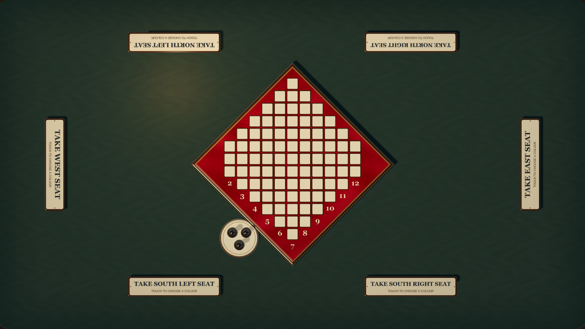
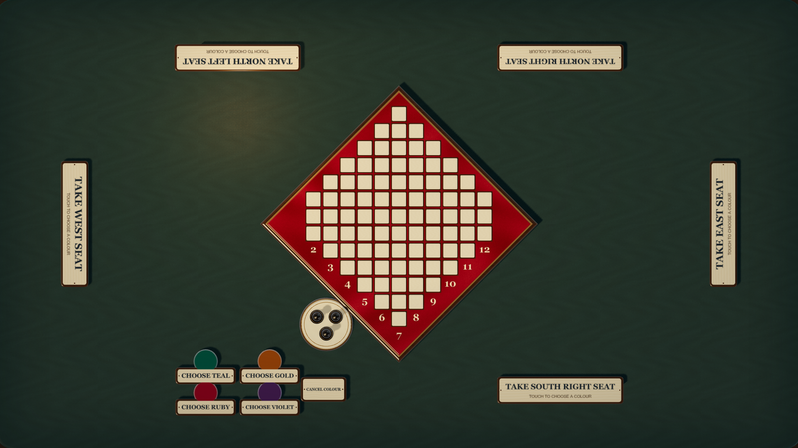
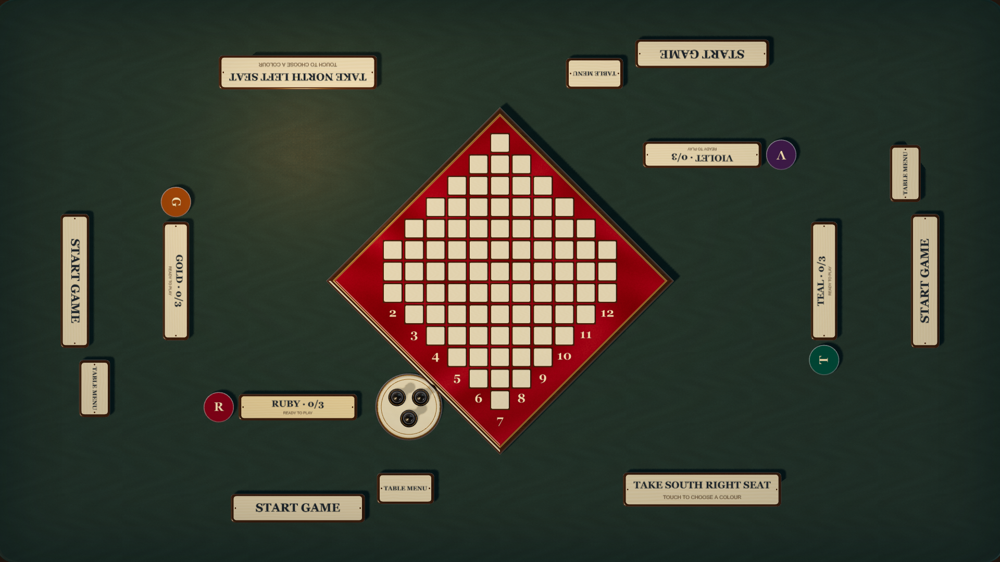

# Walk-up touch table

Open **`/tt/`** on the horizontal 55-inch touchscreen. It immediately shows the
board and six unoccupied places: two on each long edge and one on each short
edge. There is no welcome form, player-name field, table code, or room dialog.

1. Touch an empty seat.
2. Choose an available colour: Teal, Gold, Ruby, or Violet. Touch either the
   painted colour piece or its labelled plaque. Taken colours are inactive.
3. Other people choose their seats and colours in the same way.
4. Once two to four colours are present, **Start game** appears beside their
   seats. Any seated colour can start.
5. Play: the opening throw is automatic. A pairing moves the pawns immediately,
   and can be changed until Roll again or Stop & save. The board faces the active
   colour; their dice and controls move to their edge.

A new game allocates a fresh room internally and returns to the empty board.
Reload recovers the current game and its anonymous seats automatically. People
never enter or manage room details. During play, a colour’s badge can move that
person to an empty physical place. Other badges continue to face their owners.

The active colour’s **Table menu** provides speed, fullscreen, rules, game-log
export, and New game. Its dialog appears near that person and faces the same
edge. Standard/Fast/Blazing and reduced motion apply to board turns and dice
delivery. The dice dock follows the inset perimeter and remains inside the
screen throughout the handoff. The board, materials, dice, pieces, and game
animation sampler are shared with desktop, phone, and the animation lab.

## Identity and replay

Each colour has a separate, persisted anonymous Firebase Auth session. Protocol
3 records the person’s `sit {seat,colour}` choice; display labels come from the
colour, so no player-name input or synthetic create/join action is needed. Any
seated colour can submit the user’s Start action. Game outcomes and forced rolls
remain deterministic projections of the log. Earlier protocol-1/2 histories
retain their original semantics.

The room identifier is generated and retained internally, per preview namespace.
It is absent from the address bar and user-facing controls. Anonymous sessions
and in-game physical display adjustments persist on the device. Clearing browser
storage loses recovery of those anonymous seats, as with the existing online
profile. Other devices do not gain authority over the colours on this screen.

## Native render review

The walk-up E2E story uses native touch at 1920 × 1080 and 3840 × 2160. It checks
that the route has no textboxes or room parameters, unavailable colours cannot be
chosen, four distinct identities own the moves, a second colour can start,
controls fit on all four edges, reload recovers the game, and New game resets to
a fresh hidden room. CI publishes the full 4K capture as a review artifact.

### Arrive

### Choose a colour

### Ready to start

### Play from every edge

