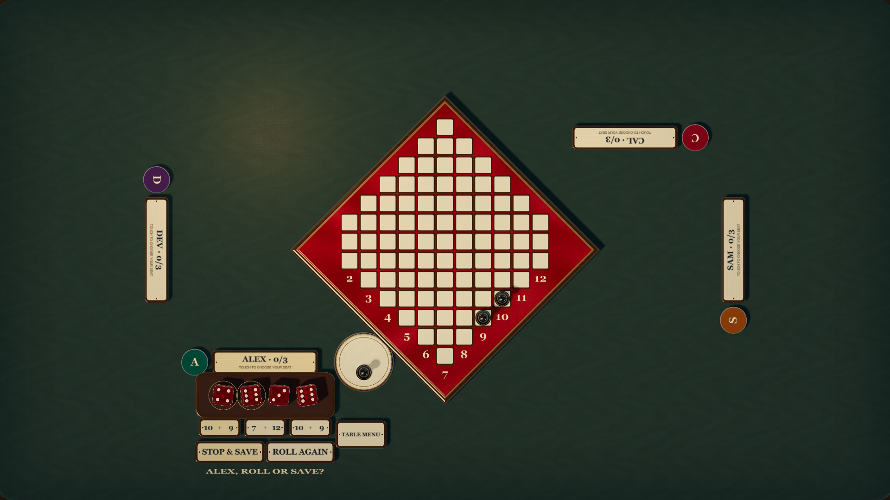
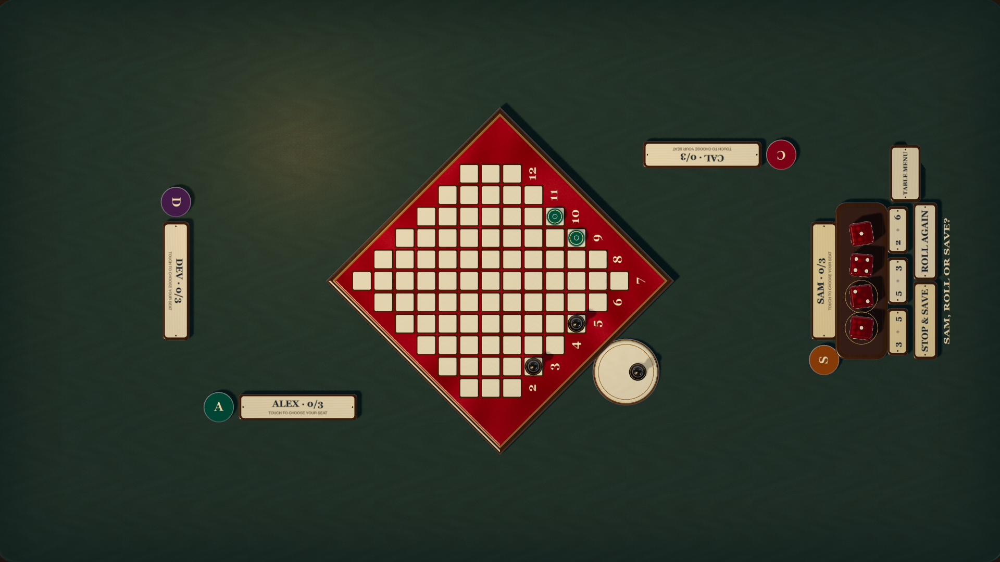
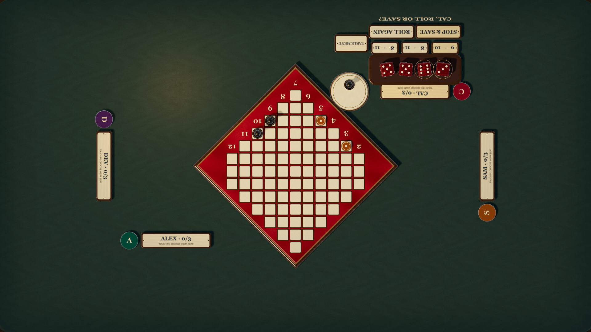
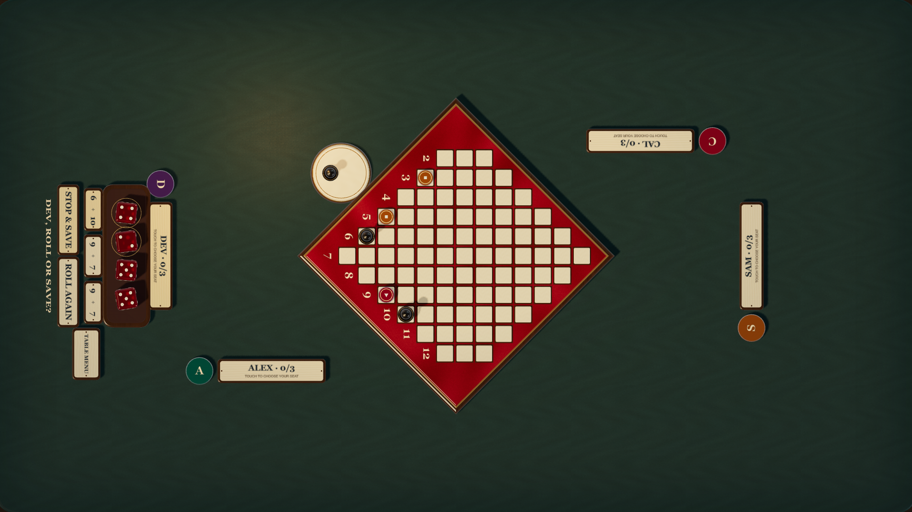

# Shared touch table

The tabletop view is designed for a horizontal 55-inch landscape touchscreen.
The game remains a two-to-four-player race. Six physical places provide two
positions on each long edge and one on each short edge; an occupied place cannot
be taken by another player.

Choose **New tabletop game** after entering the first player’s name, or select
**Tabletop · shared touch screen** in Settings. `?view=tabletop` also opens this
view directly. In the gathering, **Add player on this screen** adds another human.
Each person chooses a physical position from the seat list. Remote invitations
and optional companions remain available.

During play, tap a person’s engraved nameplate to choose another empty place.
The board faces the active player. Their ruby dice, pairing plaques, runner
choices, Roll again, Stop & save, and Table menu sit beside their edge, facing
that person. Other nameplates stay facing their owners. Turn changes spin the
board by the shortest angle and move the dice dock around the perimeter. Input
waits until movement settles. Reduced motion places it immediately; Standard,
Fast, and Blazing also apply to the handoff.

Table menu opens settings near that player and rotates the dialog toward them.
It includes fullscreen, history, and rules. Native mesh touch handlers perform
game actions and seat choice; keyboard equivalents remain available. The shared
renderer, materials, dice geometry, board, pieces, and game animation sampler are
used at both 1080p and 4K. The lab’s **Tabletop** device option makes the same
layout and handoff available for pause, scrubbing, and perspective review.

## Accounts, history, and recovery

Shared-screen humans have separate anonymous Firebase Auth sessions in named
Firebase apps. Normal `join` and move intents are written using the acting
person’s credentials. The host does not impersonate other UIDs or acquire
permission to control remote humans. No server, new game protocol, or Firestore
rule expansion is needed. Companions retain their existing host-controlled path.

Profile keys and physical seat choices persist on the device per table and
preview namespace. Reload restores identities, positions, the active person,
and the latest board directly. Physical positions, view rotation, fullscreen,
and motion clocks do not enter the canonical game log. A different device has
its own layout and anonymous identity. Clearing browser storage loses recovery
of these anonymous seats, as with the existing single-player profile.

## Native render review

These are actual touchscreen browser captures of four consecutive player turns,
not concept paintings. The four-edge E2E story also checks all native action
bounds and renders at 3840 × 2160 before verifying reload and the table menu.

### South

### East

### North

### West

